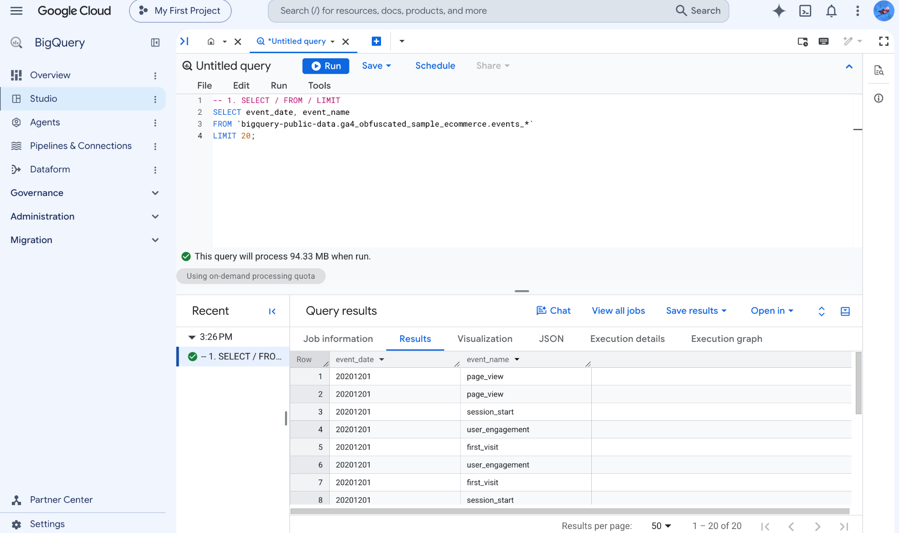
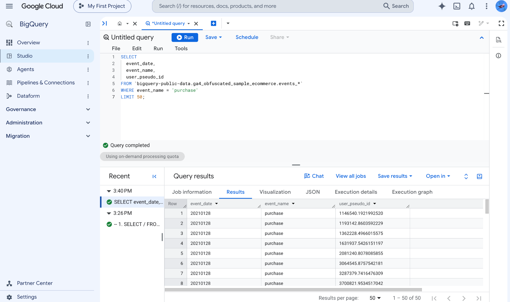
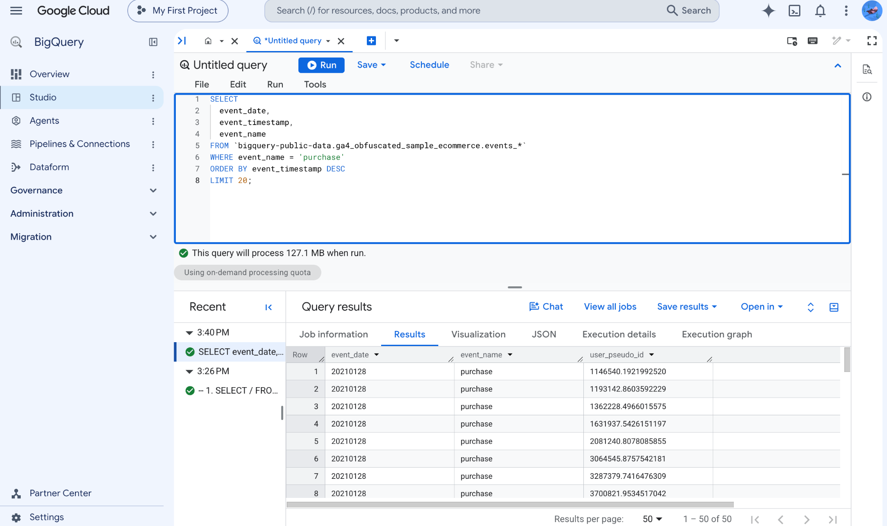
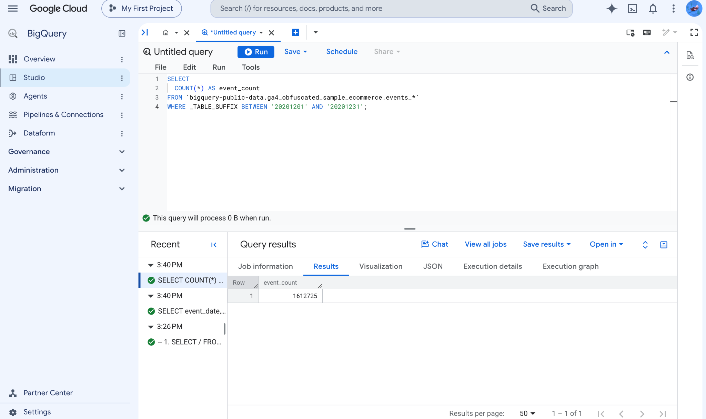
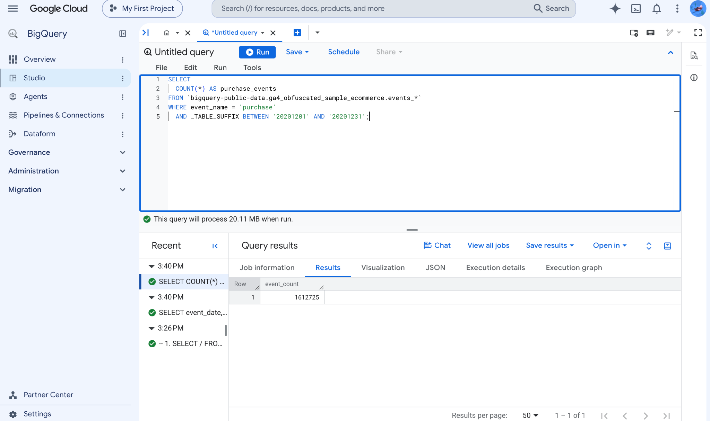
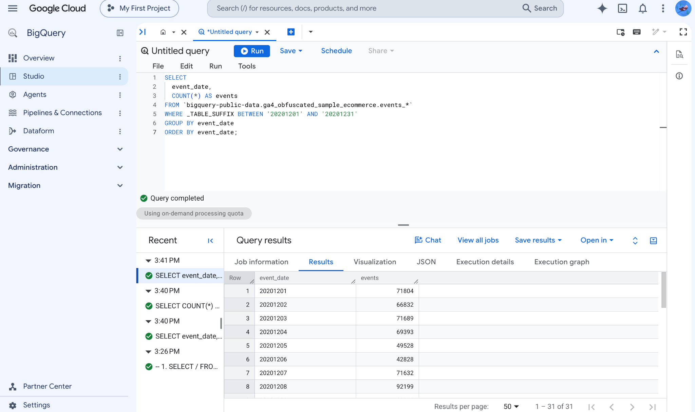
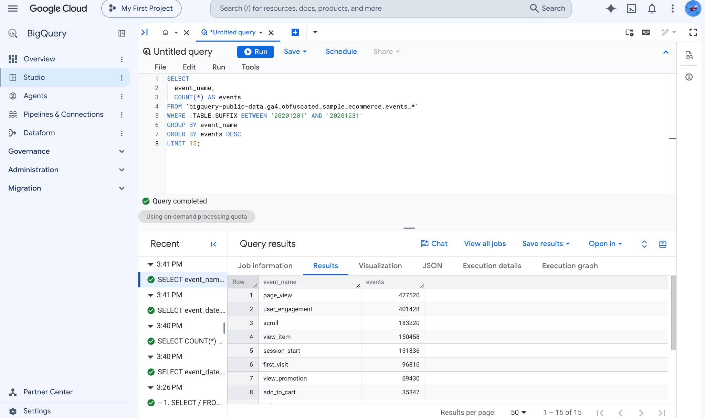
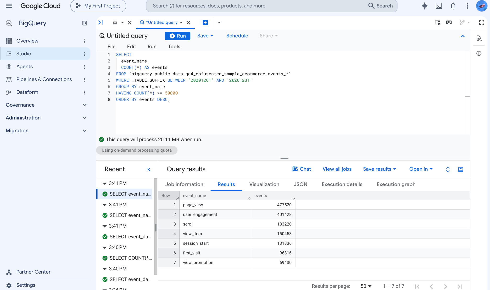
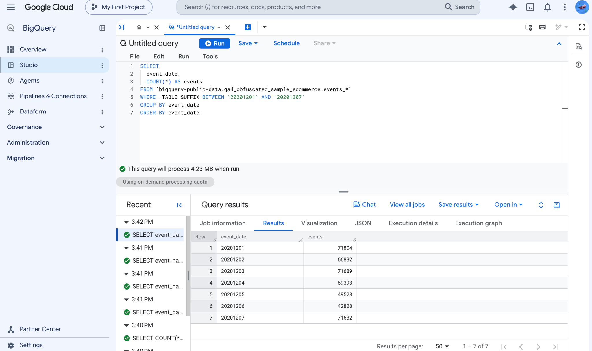

# SELECT / FROM / LIMIT

## What It Does

This query picks columns from a table and returns rows.

## Query

~~~sql
SELECT
  event_date,
  event_name
FROM `bigquery-public-data.ga4_obfuscated_sample_ecommerce.events_*`
LIMIT 20;
~~~

## Query Output

# WHERE Filters Rows

## What It Does

This query keeps only rows that match the specified condition. In this example,
only purchase events are returned.

## Query

~~~sql
SELECT
  event_date,
  event_name,
  user_pseudo_id
FROM `bigquery-public-data.ga4_obfuscated_sample_ecommerce.events_*`
WHERE event_name = 'purchase'
LIMIT 50;
~~~

## Query Output

# ORDER BY Sorts Results

## What It Does

This query sorts rows in ascending or descending order. The newest purchase
events appear first because the timestamps are sorted in descending order.

## Query

~~~sql
SELECT
  event_date,
  event_timestamp,
  event_name
FROM `bigquery-public-data.ga4_obfuscated_sample_ecommerce.events_*`
WHERE event_name = 'purchase'
ORDER BY event_timestamp DESC
LIMIT 20;
~~~

## Query Output

# COUNT, SUM, AVG, MIN, MAX

## What They Do

Aggregate functions summarize many rows into a smaller number of values. The
lecture examples below use COUNT to summarize event data.

## Count Total Events in a Date Range

### Query

~~~sql
SELECT
  COUNT(*) AS event_count
FROM `bigquery-public-data.ga4_obfuscated_sample_ecommerce.events_*`
WHERE _TABLE_SUFFIX BETWEEN '20201201' AND '20201231';
~~~

### Query Output

## Count Purchases in a Date Range

### Query

~~~sql
SELECT
  COUNT(*) AS purchase_events
FROM `bigquery-public-data.ga4_obfuscated_sample_ecommerce.events_*`
WHERE event_name = 'purchase'
  AND _TABLE_SUFFIX BETWEEN '20201201' AND '20201231';
~~~

### Query Output

# GROUP BY Controls the Grain

## What It Does

GROUP BY defines what one row in the result represents, such as one day or one
event name.

## Events by Day

### Query

~~~sql
SELECT
  event_date,
  COUNT(*) AS events
FROM `bigquery-public-data.ga4_obfuscated_sample_ecommerce.events_*`
WHERE _TABLE_SUFFIX BETWEEN '20201201' AND '20201231'
GROUP BY event_date
ORDER BY event_date;
~~~

### Query Output

## Top Event Types

### Query

~~~sql
SELECT
  event_name,
  COUNT(*) AS events
FROM `bigquery-public-data.ga4_obfuscated_sample_ecommerce.events_*`
WHERE _TABLE_SUFFIX BETWEEN '20201201' AND '20201231'
GROUP BY event_name
ORDER BY events DESC
LIMIT 15;
~~~

### Query Output

# HAVING Filters After Grouping

## What It Does

HAVING filters aggregated results after GROUP BY has created the groups.

## Query

~~~sql
SELECT
  event_name,
  COUNT(*) AS events
FROM `bigquery-public-data.ga4_obfuscated_sample_ecommerce.events_*`
WHERE _TABLE_SUFFIX BETWEEN '20201201' AND '20201231'
GROUP BY event_name
HAVING COUNT(*) >= 50000
ORDER BY events DESC;
~~~

## Query Output

# Wildcard Tables + _TABLE_SUFFIX

## What It Does

GA4 exports are stored in daily tables such as events_20201201. The wildcard
table name queries multiple daily tables, while the _TABLE_SUFFIX filter limits
the date range scanned.

## Query

~~~sql
SELECT
  event_date,
  COUNT(*) AS events
FROM `bigquery-public-data.ga4_obfuscated_sample_ecommerce.events_*`
WHERE _TABLE_SUFFIX BETWEEN '20201201' AND '20201207'
GROUP BY event_date
ORDER BY event_date;
~~~

## Query Output

## Project links
BigQuerySQLBasics
- GitHub repository: [BigQuery SQL Basics on GitHub](https://github.com/falasol/BigQuerySQLBasics)  
- Published GitHub Pages report: [BigQuery SQL Basics HTML report](https://falasol.github.io/BigQuerySQLBasics/Frank-Renn-lecture1-ga4.html)
