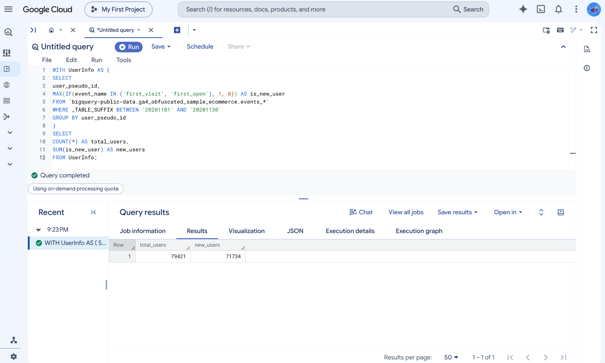
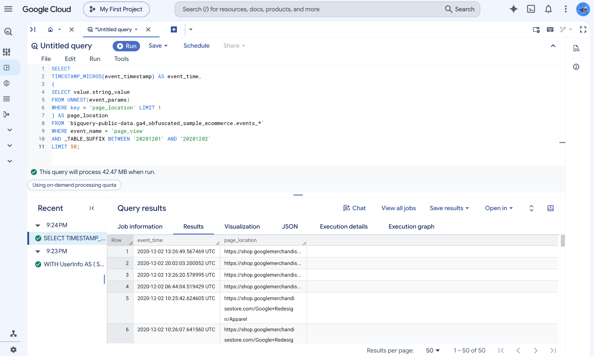
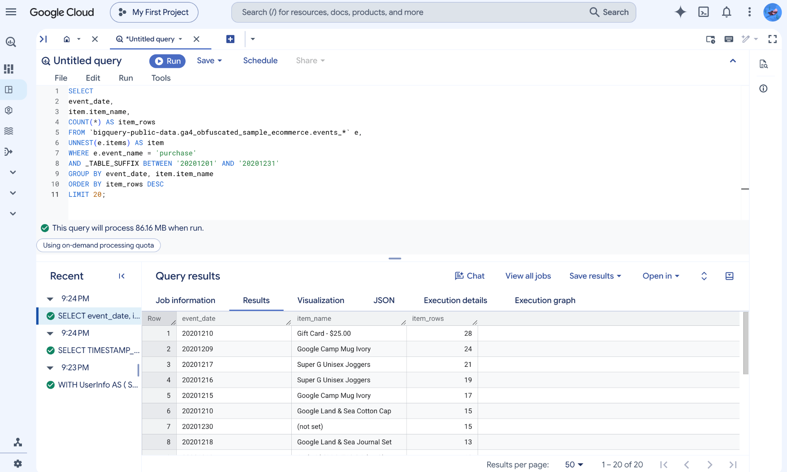
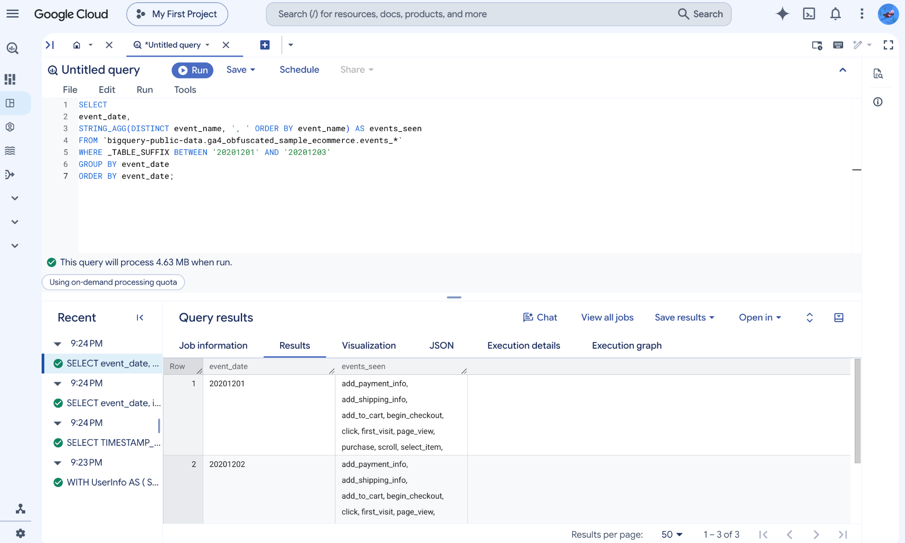
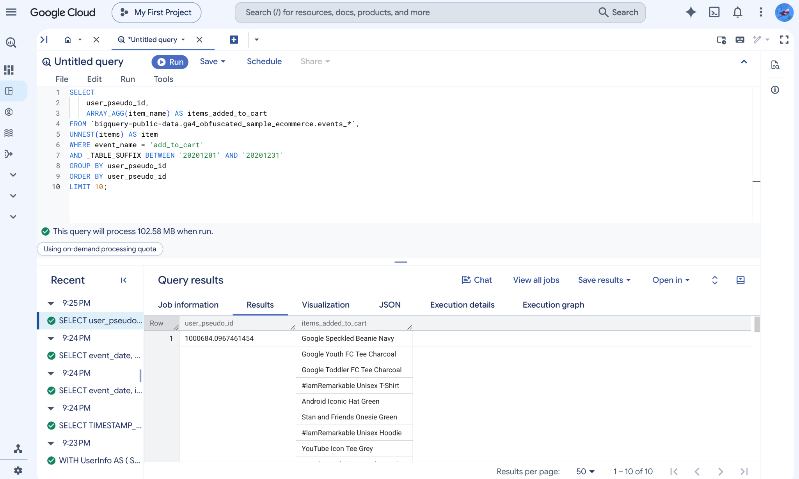
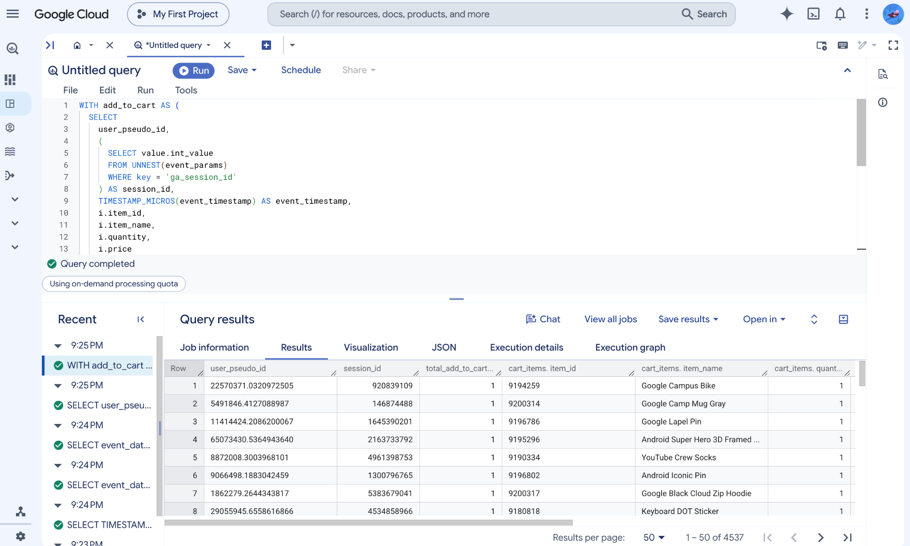
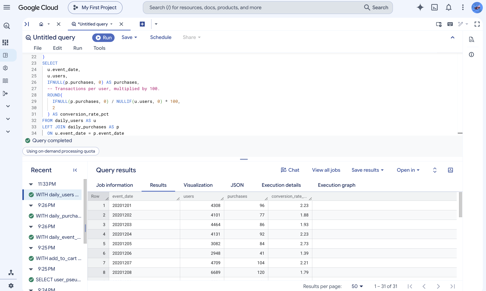
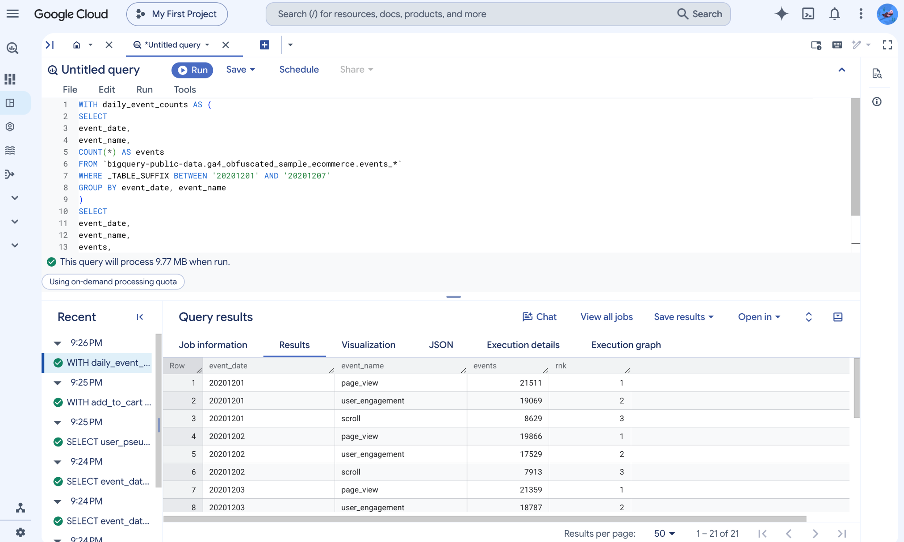
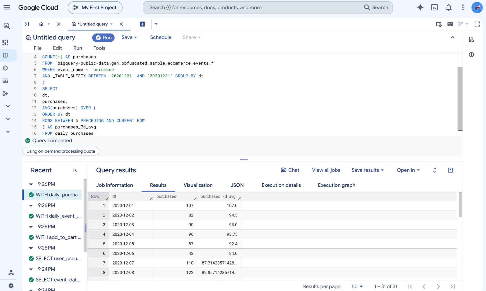
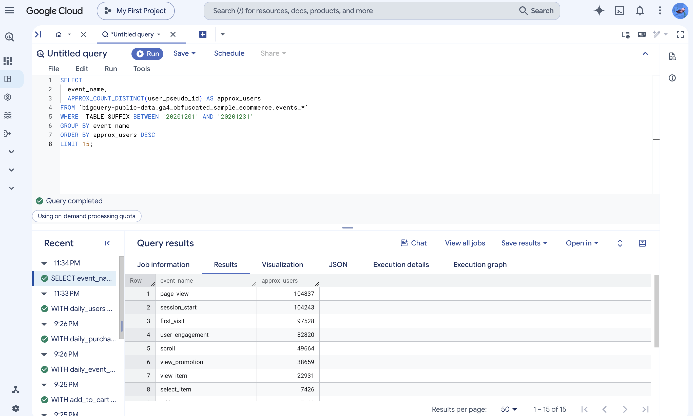

# CTEs (WITH) to structure logic

## Total users + new users

**What the query does.** The `UserInfo` CTE groups November events by
`user_pseudo_id`. `MAX(IF(...))` flags a user when at least one
`first_visit` or `first_open` event appears in the period. The outer
query counts the user groups and sums the new-user flags.

```sql
-- Create one row per user and flag first-visit or first-open events.
WITH UserInfo AS (
  SELECT
    user_pseudo_id,
    MAX(
      IF(event_name IN ('first_visit', 'first_open'), 1, 0)
    ) AS is_new_user
  FROM `bigquery-public-data.ga4_obfuscated_sample_ecommerce.events_*`
  WHERE _TABLE_SUFFIX BETWEEN '20201101' AND '20201130'
  GROUP BY user_pseudo_id
)
SELECT
  COUNT(*) AS total_users,
  SUM(is_new_user) AS new_users
FROM UserInfo;
```

{width=100%}

**Output interpretation.** The output contains **79,421 total user
groups** and **71,734 new-user groups**. About **90.32%** of the groups
were flagged as new within November. These counts use the identifiers
and events in the sample; they should not be interpreted as a count of
distinct real people.

# Arrays + UNNEST (the GA4 superpower)

## Pattern A — Scalar subquery extraction (simple, safe)

**What the query does.** This query selects page-view events and converts
their microsecond timestamps into readable timestamps. A scalar subquery
searches the `event_params` array for `page_location`, preserving one
output row per selected event.

```sql
-- Extract one page_location value without expanding the event rows.
SELECT
  TIMESTAMP_MICROS(event_timestamp) AS event_time,
  (
    SELECT value.string_value
    FROM UNNEST(event_params)
    WHERE key = 'page_location'
    LIMIT 1
  ) AS page_location
FROM `bigquery-public-data.ga4_obfuscated_sample_ecommerce.events_*`
WHERE event_name = 'page_view'
  AND _TABLE_SUFFIX BETWEEN '20201201' AND '20201202'
LIMIT 50;
```

{width=100%}

**Output interpretation.** The query returns **50 rows** with
`event_time` and `page_location`. Visible rows include December 2
timestamps and Google Merchandise Store URLs, including an Apparel
page. Because the query has `LIMIT 50` and no `ORDER BY`, this is a
limited, unordered set of events rather than a chronological list of
the first 50 visits.

## Pattern B — Flattening (UNNEST in FROM) for item-level analysis

**What the query does.** `UNNEST(e.items)` expands each purchase event
into one row for each item entry. The query groups those rows by date
and item name and returns the 20 groups with the largest row counts.
The resulting grain is a date–item combination; `item_rows` is not the
sum of product quantities.

```sql
-- Expand each purchase into its item rows, then count by day and item.
SELECT
  event_date,
  item.item_name,
  COUNT(*) AS item_rows
FROM `bigquery-public-data.ga4_obfuscated_sample_ecommerce.events_*` AS e,
  UNNEST(e.items) AS item
WHERE e.event_name = 'purchase'
  AND _TABLE_SUFFIX BETWEEN '20201201' AND '20201231'
GROUP BY event_date, item.item_name
ORDER BY item_rows DESC
LIMIT 20;
```

{width=100%}

**Output interpretation.** The highest displayed group is
**Gift Card - $25.00** on **December 10**, with **28 item rows**. It is
followed by **Google Camp Mug Ivory** on December 9 with **24 rows**
and **Super G Unisex Joggers** on December 17 with **21 rows**.
These are daily item-row counts, rather than monthly sales totals.

# STRING_AGG, ARRAY_AGG (useful aggregations)

## Example: show a few event_names seen per day

**What the query does.** `STRING_AGG` combines event names into one
comma-separated string per day. `DISTINCT` removes repeated names,
and the ordering inside the aggregate sorts the names alphabetically.
The final `ORDER BY` sorts the daily rows.

```sql
-- Combine each day's distinct event names into an alphabetical list.
SELECT
  event_date,
  STRING_AGG(
    DISTINCT event_name, ', ' ORDER BY event_name
  ) AS events_seen
FROM `bigquery-public-data.ga4_obfuscated_sample_ecommerce.events_*`
WHERE _TABLE_SUFFIX BETWEEN '20201201' AND '20201203'
GROUP BY event_date
ORDER BY event_date;
```

{width=100%}

**Output interpretation.** The output contains **three daily rows**.
The visible lists include `add_payment_info`, `add_shipping_info`,
`add_to_cart`, `begin_checkout`, `click`, `first_visit`, `page_view`,
`purchase`, `scroll`, and `select_item`. This summarizes which types
of events occurred, rather than how often each occurred.

## Example: Build a “session cart summary” (top items a user added to cart)

### Use Case 1:

**What the query does.** This query expands the items in add-to-cart
events and uses `ARRAY_AGG` to collect item names for each user.
It returns ten user groups ordered by identifier. Because the
grouping uses only `user_pseudo_id`, each array can combine items
from multiple sessions during December.

```sql
-- Collect item names from add_to_cart events for each user.
SELECT
  user_pseudo_id,
  ARRAY_AGG(item.item_name) AS items_added_to_cart
FROM `bigquery-public-data.ga4_obfuscated_sample_ecommerce.events_*`,
  UNNEST(items) AS item
WHERE event_name = 'add_to_cart'
  AND _TABLE_SUFFIX BETWEEN '20201201' AND '20201231'
GROUP BY user_pseudo_id
ORDER BY user_pseudo_id
LIMIT 10;
```

{width=100%}

**Output interpretation.** The result contains **10 user groups**.
The first displayed user's array includes **Google Speckled Beanie
Navy**, **Google Youth FC Tee Charcoal**, and **Google Toddler FC Tee
Charcoal**, among other items. Multiple item lines in the result
grid belong to the same array. Duplicate item names may remain,
and the array order is unspecified because `ARRAY_AGG` has no
internal `ORDER BY`.

### Use Case 2:

**What the query does.** The CTE extracts `ga_session_id` and item
details from add-to-cart events. The outer query groups by both user
and session, removes missing session IDs, and builds an array of up
to ten item records, ordered by quantity and then timestamp. The
count is computed before the ten-item array limit.

```sql
-- Extract session IDs and keep one row per added-to-cart item entry.
WITH add_to_cart AS (
  SELECT
    user_pseudo_id,
    (
      SELECT value.int_value
      FROM UNNEST(event_params)
      WHERE key = 'ga_session_id'
    ) AS session_id,
    TIMESTAMP_MICROS(event_timestamp) AS event_timestamp,
    i.item_id,
    i.item_name,
    i.quantity,
    i.price
  FROM `bigquery-public-data.ga4_obfuscated_sample_ecommerce.events_*`,
    UNNEST(items) AS i
  WHERE event_name = 'add_to_cart'
    AND _TABLE_SUFFIX BETWEEN '20210101' AND '20211231'
)
SELECT
  user_pseudo_id,
  session_id,
  -- The lecture alias is retained; COUNT(*) counts item rows here.
  COUNT(*) AS total_add_to_cart_events,
  ARRAY_AGG(
    STRUCT(item_id, item_name, quantity, price, event_timestamp)
    ORDER BY quantity DESC, event_timestamp ASC
    LIMIT 10
  ) AS cart_items
FROM add_to_cart
WHERE session_id IS NOT NULL
GROUP BY user_pseudo_id, session_id;
```

{width=100%}

**Output interpretation.** The output reports **4,537 user–session
groups**. Visible examples include **Google Campus Bike**,
**Google Camp Mug Gray**, and **Google Lapel Pin**; the displayed
rows each show a count of 1 and quantity of 1. Despite its name,
`total_add_to_cart_events` counts unnested item rows, so an event
containing several items can contribute more than one. The 2021
filter covers only January in this sample, which ends on
January 31, 2021.

# Joins (start with INNER and LEFT)

## Example: daily users joined with daily purchases (using CTEs)

**What the query does.** Two CTEs calculate daily distinct users and
daily distinct transaction IDs. A `LEFT JOIN` retains all dates in
the user summary, and `IFNULL` replaces missing purchase counts
with zero. `NULLIF` protects the division from a zero denominator.
The lecture's `conversion_rate_pct` is transactions divided by
users, multiplied by 100; it does not count the percentage of
distinct users who purchased.

```sql
-- Build separate daily summaries before joining on event_date.
WITH daily_users AS (
  SELECT
    event_date,
    COUNT(DISTINCT user_pseudo_id) AS users
  FROM `bigquery-public-data.ga4_obfuscated_sample_ecommerce.events_*`
  WHERE _TABLE_SUFFIX BETWEEN '20201201' AND '20201231'
  GROUP BY event_date
),
daily_purchases AS (
  SELECT
    event_date,
    -- Follow the lecture's transaction_id parameter extraction.
    COUNT(DISTINCT (
      SELECT value.string_value
      FROM UNNEST(event_params)
      WHERE key = 'transaction_id'
    )) AS purchases
  FROM `bigquery-public-data.ga4_obfuscated_sample_ecommerce.events_*`
  WHERE event_name = 'purchase'
    AND _TABLE_SUFFIX BETWEEN '20201201' AND '20201231'
  GROUP BY event_date
)
SELECT
  u.event_date,
  u.users,
  IFNULL(p.purchases, 0) AS purchases,
  -- Transactions per user, multiplied by 100.
  ROUND(
    IFNULL(p.purchases, 0) / NULLIF(u.users, 0) * 100,
    2
  ) AS conversion_rate_pct
FROM daily_users AS u
LEFT JOIN daily_purchases AS p
  ON u.event_date = p.event_date
ORDER BY u.event_date;
```

{width=100%}

**Output interpretation.** The output contains **31 daily rows**.
On **December 1**, there are **4,308 users** and **96 distinct
transactions**, producing a `conversion_rate_pct` value of
**2.23**. On **December 2**, there are **4,101 users** and
**77 transactions**, producing a value of **1.88**.

Among the visible December 1–8 rows, the highest transaction-to-user
ratio is **2.73** on **December 5**, while the lowest is **1.39**
on **December 6**. These values express transactions per 100 users.
They do not directly measure the percentage of unique users who
purchased because one user can complete multiple transactions.

# Window functions + QUALIFY

## Top 3 event types per day (RANK) + QUALIFY

**What the query does.** The CTE counts each event type within each
day. `RANK` assigns ranks separately for each date, and `QUALIFY`
keeps ranks up to three. Tied counts receive the same rank, so
the query can return more than three rows per day when ties occur.

```sql
-- First count events for each date and event type.
WITH daily_event_counts AS (
  SELECT
    event_date,
    event_name,
    COUNT(*) AS events
  FROM `bigquery-public-data.ga4_obfuscated_sample_ecommerce.events_*`
  WHERE _TABLE_SUFFIX BETWEEN '20201201' AND '20201207'
  GROUP BY event_date, event_name
)
SELECT
  event_date,
  event_name,
  events,
  RANK() OVER (
    PARTITION BY event_date
    ORDER BY events DESC
  ) AS rnk
FROM daily_event_counts
QUALIFY rnk <= 3
ORDER BY event_date, rnk;
```

{width=100%}

**Output interpretation.** The displayed result contains **21 rows**
for December 1–7. On **December 1**, `page_view` ranks first with
**21,511 events**, `user_engagement` ranks second with **19,069**,
and `scroll` ranks third with **8,629**. The same ranking appears
in the visible December 2 rows. These values count events, so
repeated actions by the same user can contribute multiple times.

## Rolling 7-day average of daily purchases

**What the query does.** The CTE converts the date string into a
date and counts purchase events per day. The window computes an
average across the current row and up to six previous rows
without collapsing the daily results. The first six rows use
the shorter available window. Because the frame uses `ROWS`,
seven rows represent seven calendar days only when the dates
are consecutive.

```sql
-- Count purchase events for each date.
WITH daily_purchases AS (
  SELECT
    PARSE_DATE('%Y%m%d', event_date) AS dt,
    COUNT(*) AS purchases
  FROM `bigquery-public-data.ga4_obfuscated_sample_ecommerce.events_*`
  WHERE event_name = 'purchase'
    AND _TABLE_SUFFIX BETWEEN '20201201' AND '20201231'
  GROUP BY dt
)
SELECT
  dt,
  purchases,
  AVG(purchases) OVER (
    ORDER BY dt
    ROWS BETWEEN 6 PRECEDING AND CURRENT ROW
  ) AS purchases_7d_avg
FROM daily_purchases
ORDER BY dt;
```

{width=100%}

**Output interpretation.** The result contains **31 daily rows**.
Purchases are **107** on December 1 and **82** on December 2, so
the first two rolling averages are **107.0** and **94.5**.
On December 7, purchases are **110**, while the seven-row average
is approximately **87.71**. The rolling measure smooths daily
variation. Here `purchases` counts purchase event rows, whereas
Query 7 counts distinct transaction IDs. For example, December 1
has **107 purchase event rows** but **96 distinct transactions**.

# Approximate functions (performance-minded)

## Approx distinct users per event type

**What the query does.** `APPROX_COUNT_DISTINCT` estimates the number
of distinct user identifiers associated with each event type.
The query sorts the estimates from largest to smallest and
returns up to 15 event types. Approximation can reduce the
resources needed for large distinct-count calculations, at the
cost of exactness. A user can appear under multiple event types,
so the estimates should not be added to obtain an overall user total.

```sql
-- Estimate distinct users for each event type.
SELECT
  event_name,
  APPROX_COUNT_DISTINCT(user_pseudo_id) AS approx_users
FROM `bigquery-public-data.ga4_obfuscated_sample_ecommerce.events_*`
WHERE _TABLE_SUFFIX BETWEEN '20201201' AND '20201231'
GROUP BY event_name
ORDER BY approx_users DESC
LIMIT 15;
```

{width=100%}

**Output interpretation.** The output contains **15 event types**.
`page_view` has the highest approximate distinct user count at
**104,837**, followed by `session_start` at **104,243** and
`first_visit` at **97,528**. Other visible counts include
**82,820** for `user_engagement`, **49,664** for `scroll`,
**22,931** for `view_item`, and **7,426** for `select_item`.

The visible results show that page views and session starts are
associated with more distinct user identifiers than item views
or item selections. These are approximate counts, and the same
user can appear in several event categories.

# Appendix {.unnumbered}


## Project links
BigQuerySQLBasics
- GitHub repository: [BigQuery SQL Basics on GitHub](https://github.com/falasol/BigQuerySQLBasics)  
- Published GitHub Pages report: [BigQuery SQL Basics HTML report](https://falasol.github.io/BigQuerySQLBasics/Frank-Renn-lecture2.html)
